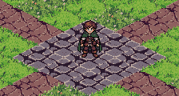
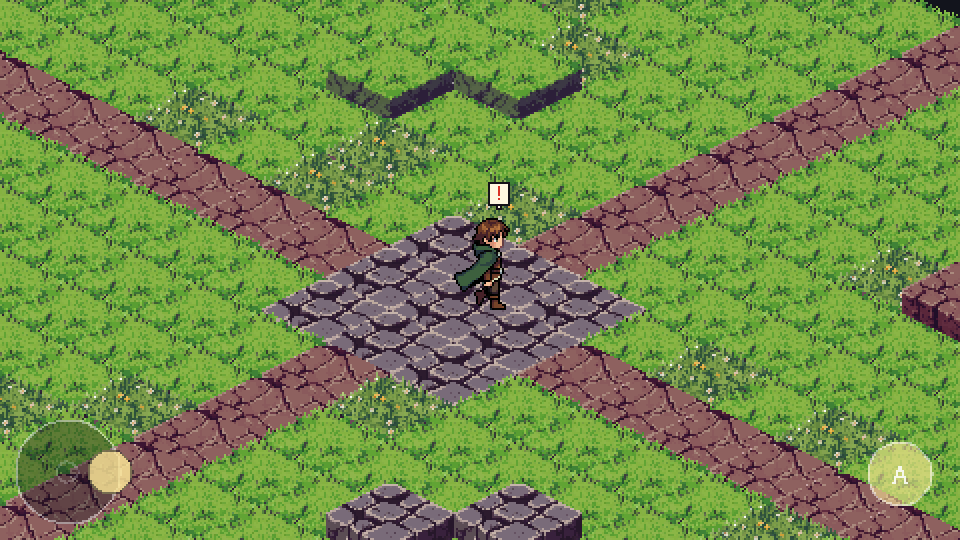
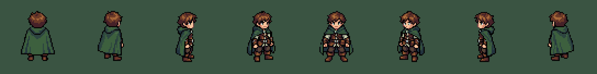
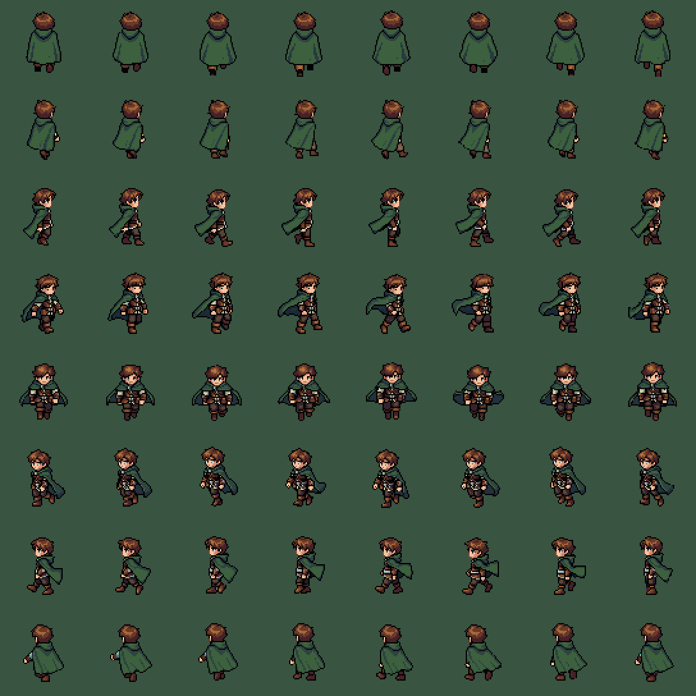

# Isometric RPG — character & graphics prototype

Graphical foundation for an isometric pixel-art RPG (PC + mobile, multiplayer
later). This milestone contains the isometric test ground, the first playable
character, PC + Android controls and builds — no combat, inventory, quests or
networking yet.



Every sprite and tile here was generated with the real **PixelLab API v2**
(see [PixelLab pipeline](#pixellab-pipeline)). Nothing is a placeholder.

## Run it

Requires **Godot 4.7** (GL Compatibility renderer: PC, Android, web).

```sh
godot --path .            # opens the movement test scene (scenes/main.tscn)
```

| Action | PC | Gamepad | Touch (Android) |
|---|---|---|---|
| Move (8 directions) | **WASD** on QWERTY = **ZQSD** on AZERTY (physical key positions), arrow keys | left stick | joystick, bottom-left |
| Run / sprint | hold **Shift** | A | hold the **>>** button, or push the joystick to full tilt |
| Interact (placeholder) | **E** / **Space** | X | **A** button, bottom-right |

The touch HUD shows automatically on Android/iOS. On PC it stays hidden, unless
a real touchscreen is touched or you pass `-- --touch-ui`.



## Build

Both presets are in `export_presets.cfg` (committed). Build outputs go to
`build/` (git-ignored).

```sh
godot --headless --path . --export-debug   "Android"         build/android/IsoRPG-debug.apk
godot --headless --path . --export-release "Windows Desktop" build/windows/IsoRPG.exe
adb install -r build/android/IsoRPG-debug.apk
```

| | Android preset | Windows preset |
|---|---|---|
| Output | debug APK, signed with the Android debug key (v2 + v3) | single `.exe`, game data embedded |
| Package / name | `com.p1kacat.isorpg`, "Iso RPG", version from `set_version.py` | Iso RPG |
| CPU | **arm64-v8a** only | x86_64 |
| Orientation | landscape (`userLandscape`), immersive, edge-to-edge (safe area handled in-game) | 1440 × 810 window, resizable |
| Permissions | **INTERNET** only (update check) | n/a |

**Android toolchain** (one-time; this is what the build machine used):
- Godot 4.7 export templates in `~/.local/share/godot/export_templates/4.7.stable/`
  (`android_debug.apk`, `android_release.apk`, Windows templates).
- JDK 17+ (built with OpenJDK 21). Editor setting `export/android/java_sdk_path`.
- Android SDK with `platform-tools` and `build-tools;35.0.1` (apksigner, zipalign).
  Editor setting `export/android/android_sdk_path`.
- A debug keystore (`keytool -genkeypair -keystore debug.keystore -alias androiddebugkey
  -storepass android -keypass android -keyalg RSA -validity 10000 -dname "CN=Android Debug,O=Android,C=US"`).
  Editor setting `export/android/debug_keystore`.
- Gradle is **not** needed; the preset uses Godot's prebuilt APK template.

A store/release build would additionally need a private release keystore
(`keystore/release*` in the preset, or `GODOT_ANDROID_KEYSTORE_RELEASE_*` env vars).

## NPCs, dialogue and shop

Eldric, the first NPC, stands next to the central crossroads. Walk up to him:
a small speech bubble appears; press **E** (PC) or the **A** button (Android).

| | PC | Android |
|---|---|---|
| Talk | E | A button |
| Confirm / next line | Enter, Space, E, click on the box | tap the box |
| Choices | arrow keys + Enter, mouse | tap |
| Cancel / close | Escape | "Non merci" / "Fermer" |
| Shop | arrows, Enter on an item (or "Acheter"), Escape | tap an item, tap again or "Acheter"; drag to scroll |

Text appears with a typewriter effect; confirm once to show the whole line,
again to continue. Double confirmations are filtered (grace period after
opening, minimum delay between inputs, choices armed after they appear).
While a conversation or the shop is open, movement is locked, the touch
movement controls are hidden and the camera frames both characters in the
part of the screen the windows leave free.

**Architecture** (each layer independent; only the director knows them all)

| Layer | Files |
|---|---|
| Data | `data/items/*.tres` (ItemDefinition), `data/shops/*.tres` (MerchantStock), `data/dialogues/*.json`, `data/npcs/*.tres` (NpcDefinition) |
| Model | `scripts/inventory/` Inventory, PlayerState (gold + inventory, serializable) |
| Rules | `scripts/trade/trade_service.gd`: `request_purchase()` validates (item exists, sold here, stock, gold, inventory space) and applies atomically; returns a result code |
| Logic | `scripts/dialogue/` DialogueData (loader/validator), DialogueManager (graph runner, flags, actions) |
| World | `scripts/npc/npc.gd`, `scripts/interaction/` Interactable + PlayerInteractor |
| Views | `scripts/ui/dialogue_ui.gd`, `shop_ui.gd`, `ui_theme.gd` (pixel-art 9-slice frames from `tools/ui/make_ui_art.py`), `safe_area.gd` |
| Glue | `scripts/world/interaction_director.gd` |

The shop UI never edits gold or inventory: it asks `TradeService` and shows
the result. For a multiplayer server, a networked TradeService keeps the same
`request_purchase` coroutine, the server runs `validate_and_apply` on its
authoritative PlayerState and the client applies the returned state with
`PlayerState.apply_dict()`.

**Dialogue format** (`data/dialogues/eldric_merchant.json`): nodes with
`text`, `choices` (`text`, `next`, optional `condition` on a flag, `cancel`),
`actions` (e.g. `{"type": "open_shop"}`), `set_flags`, `next` (`"end"` closes).
A line followed by a choices-only node shows the choices under that line.
Flags persist between conversations, ready for quests.

**Adding an NPC**: generate it (`pixellab_client.py --npc NAME create-character /
animate / zip / portrait`, then `tools/pixellab/export_npc.py`), write
`data/npcs/NAME.tres` + a dialogue JSON (+ optional shop `.tres`), and place a
`scenes/npc.tscn` instance with that definition. No code changes.

**Generated with PixelLab for this milestone** (30 generations): Eldric with 8
rotations (`create-character-v3`, 2), idle x 8 directions (`characters/animations`
pixminimax, 8), dialogue portrait from his own sprite (`portrait-character-pro`
character_to_portrait, 15), item and coin icons (`create-image-pixen`, 5).

## Updates (launcher + GitHub Releases)

The exe / APK start on a small **launcher** (`scenes/launcher.tscn`) that
checks the latest GitHub Release before the game starts. It reads
`github.com/<repo>/releases/latest/download/manifest.json` (GitHub's CDN) and
never calls `api.github.com`, whose anonymous limit (60 requests/hour per IP)
is easily exhausted on shared IPs:

| Release changes… | What the launcher does |
|---|---|
| game content only (scenes, gameplay scripts, sprites, new classes…) | downloads `game-<platform>.pck` (~0.4 MB), checks its SHA-256, **hot-loads it and starts the game: no restart, no reinstall** (PC and Android) |
| the "base" (engine/project settings, input map, autoloads, export settings, launcher) | full update: Windows downloads `IsoRPG-windows.zip`, swaps `IsoRPG.exe` and restarts once; Android offers the new APK (or "play anyway") |
| nothing / offline / GitHub down | starts the game immediately (with the last downloaded content) |

`tools/release/set_version.py` writes `build_info.json` with the version and
the **base_id** (a hash of the base files, version numbers excluded). The
launcher compares it with the release's `manifest.json` to decide between
the two update kinds. Downloaded content is cached in `user://content/`.

**Publishing a version**

```sh
python3 tools/release/set_version.py 0.4.1
git commit -am "Release v0.4.1" && git push      # to the default branch
```

(or push a tag `v0.4.1`). `.github/workflows/release.yml` then creates the
tag and release if they don't exist yet, builds
with `tools/release/build.sh` and publishes `manifest.json`,
`game-windows.pck`, `game-android.pck`, `IsoRPG-windows.zip` and `IsoRPG.apk`.

**One-time GitHub setup**
1. The repository must be **public** (the game reads releases without
   credentials).
2. Repository secret **`ANDROID_DEBUG_KEYSTORE_BASE64`** = the Android
   signing keystore, base64-encoded (`base64 -w0 debug.keystore`). Every APK
   must be signed with the same key, or Android refuses to install it over
   the previous one. Never commit the keystore (`*.keystore` is git-ignored).

**Testing the launcher** (no GitHub needed): serve a fake
`/P1kaCat/game-project/releases/latest/download/manifest.json` and
`/P1kaCat/game-project/releases/download/vX.Y.Z/<files>`, then run
`godot --main-pack IsoRPG.exe -- --autotest --launcher-only --check-updates
--update-base-url=http://127.0.0.1:PORT --update-platform=windows
--expect-launcher=updated --expect-content-version=X.Y.Z`.

## Testing

```sh
xvfb-run godot --path . --rendering-driver opengl3 -- --autotest [--shots=/abs/dir]
godot --headless --path . --export-pack "Android" build/android/IsoRPG-android.pck
xvfb-run godot --main-pack build/android/IsoRPG-android.pck -- --autotest   # exported game data
godot --path . --resolution 2400x1080 -- --autotest --layout-only --fake-safe-area=110,0,0,0
```

`scripts/debug/autotest.gd` drives the real game. The keyboard path goes
through the InputMap actions. The touch path injects `InputEventScreenTouch` /
`InputEventScreenDrag` events in window pixels, exactly as Android delivers
them. It runs 164 checks (movement, touch, launcher, NPC/dialogue/shop), including:
- 8 directions by keyboard and by joystick: sprite, animation, normalised
  speed, iso screen direction
- idle/walk/run transitions, no per-frame animation restarts, last facing kept
- staggered key release keeps the diagonal facing; no direction flicker
  when the stick hovers on a sector boundary
- identical distance at 30/60/120 Hz physics (frame-rate independence)
- camera follow, re-centring and whole-pixel player offset
- block collision (no entry, clean stop in corners, sliding along faces) and
  the map edge
- joystick dead zone, analog intensity, full-tilt run, 360° input snapped to
  8 directions, release, OS touch cancel, focus loss
- multitouch: action button pressed while the joystick finger keeps steering
- keyboard still works with the touch HUD active; touches outside the
  controls are ignored
- HUD inside the safe area, corners only, centre unobstructed
- PixelLab assets loaded unchanged (3 animations × 8 directions, 68 × 68
  frames, nearest filtering)

## Specifications

| | |
|---|---|
| Projection | true 2:1 isometric, diamond cells **64 × 32 px** |
| Tile texture | 64 × 64 px: the top face is an exact 64 × 32 diamond centred at (32, 38), with ~10 px of earth side below |
| Character body | **31 × 47 px** (south view), 8 directions |
| Animation frame canvas | **68 × 68 px** for every frame of every animation, so nothing shifts |
| Foot pivot | **(34, 57)** in frame pixels, placed on the ground position (tile centre) |
| Rendering | ~270 px tall internal resolution, **whole-number upscaling that fills any screen** (`PixelScaler`: e.g. 480×270 ×4 on 1080p, 533×240 ×3 on 720p phones, 542×244 ×5 on 1220p), nearest-neighbour filtering, 2D transforms snapped to pixels, physics interpolation for high-refresh screens |

**Movement model.** Input and velocity live in an undistorted "ground" plane.
Acceleration and braking are framerate-independent; analog input is snapped
to the 8 sprite directions (with hysteresis) so movement always matches the
drawn facing. Collision is real physics (`CharacterBody2D.move_and_slide`)
against the map outline and raised blocks; a blocked push that would only
jitter (head-on or in an inside corner) stops cleanly instead.
`Iso.ground_to_screen()` halves the vertical component (the 2:1 camera). This
keeps diagonal speed normalised in ground space, and moving diagonally
travels exactly along the tile edges, slope (2, 1). Movement speeds are walk
65 px/s and run 150 px/s. The walk/run cycles were calibrated against the
stride measured in the generated frames (50 / 90 px/s at native frame rate),
and play proportionally faster at higher speeds, so the feet don't slide.
On screen, up/down movement runs at 75 % of the left/right speed
(`Player.vertical_speed`; strict isometric would be 50 %, which feels slow),
with diagonals still following the 2:1 tile edges.

| Animation | Frames / direction | Frame duration | Engine |
|---|---|---|---|
| idle | 4 | 200 ms | PixelLab `pixminimax`, custom breathing action |
| walk | 8 | 100 ms | PixelLab `v3`, template action `walking` |
| run  | 8 | 75 ms  | PixelLab `v3`, template action `running` |




## Asset layout

```
assets/
  characters/player/
    rotations/<dir>.png                 base 8-direction sprites (padded to 68x68)
    idle/<dir>/frame_NN.png             4 frames
    walk/<dir>/frame_NN.png             8 frames
    run/<dir>/frame_NN.png              8 frames
    spritesheets/player_{idle,walk,run,rotations}.png
    player_animations.json              metadata (read by the game)
  tiles/terrain/
    grass.png grass_flowers.png dirt.png cobblestone.png
    terrain_atlas.png  terrain.json
```

`<dir>` is one of `n ne e se s sw w nw`. Sprite-sheet **rows follow that order**
(N, NE, E, SE, S, SW, W, NW), columns are frames left to right, with no
spacing or padding. `player_animations.json` describes the frame size, pivot,
direction order and, per animation, its sheet, frame count, frame duration and
loop flag. `DirectionalSprite` builds its `SpriteFrames` from this file, so
adding an animation is just a sheet plus a JSON entry.

## Code structure

```
scenes/main.tscn               test world: terrain, y-sorted entities (blocks + player), camera, HUD
scenes/player.tscn             CharacterBody2D + DirectionalSprite + feet capsule + emote
scenes/ui/mobile_hud.tscn      CanvasLayer: TouchJoystick + TouchActionButton
scripts/core/iso.gd            2:1 projection helpers, tile size
scripts/core/direction8.gd     vector <-> 8 directions, hysteresis
scripts/core/pixel_scaler.gd   autoload: whole-number full-screen scaling
scripts/input/game_input.gd    autoload: merges keyboard/gamepad + touch into one intent
scripts/player/player.gd       movement, facing, collision response, idle/walk/run, interact hook
scripts/player/directional_sprite.gd  metadata-driven 8-dir AnimatedSprite2D
scripts/camera/follow_camera.gd       smooth, pixel-stable follow camera
scripts/world/terrain_tileset.gd      TileSet: ground + raised (solid) variants of each terrain
scripts/world/iso_terrain.gd          ground layer, test map, map-edge collision
scripts/world/iso_obstacles.gd        raised solid blocks (y-sorted with characters)
scripts/ui/touch_joystick.gd          analog stick: dead zone, multitouch, cancel, auto-centre
scripts/ui/touch_action_button.gd     round touch button -> InputMap action ("interact")
scripts/ui/mobile_hud.gd              HUD visibility, density-aware sizing, safe-area layout
scripts/launcher/launcher.gd          entry scene: update check, pack hot-load, full update
scripts/launcher/update_service.gd    GitHub Releases client, download, exe swap
scripts/debug/autotest.gd             scripted runtime verification (+ autotest_npc.gd)
```

**Extending:** new input sources only touch `GameInput`. A new on-screen
button is a `TouchActionButton` with another `action`. A new animation is a
sprite sheet plus a JSON entry. Solid scenery can use the `RAISED` tile
variant, or any physics body on collision layer 1.

## PixelLab pipeline

`tools/pixellab/pixellab_client.py` is a dependency-free client. It uses only
documented endpoints from <https://api.pixellab.ai/v2/openapi.json>.
Set `PIXELLAB_API_KEY` in your environment; the key is sent as a Bearer token
and never written anywhere. `tools/pixellab/state.json` records the character
id, animation group ids and requests, so references are reused and never
regenerated.

```sh
python3 tools/pixellab/pixellab_client.py balance
python3 tools/pixellab/pixellab_client.py create-character --size 48 --description "..."
python3 tools/pixellab/pixellab_client.py animate --key walk --mode v3 --template-action walking --wait
python3 tools/pixellab/pixellab_client.py zip --out /tmp/player.zip      # GET /characters/{id}/zip
python3 tools/pixellab/export_assets.py <unzipped dir> <tiles dir> .     # -> assets/
```

What was generated, and its cost (Tier 1 subscription generations):

| Step | Endpoint | Cost |
|---|---|---|
| Base character v1 (64 px canvas, rejected: figure ~62 px tall, too large) | `POST /create-character-v3` | 2 |
| **Base character v2**: south sprite + 8 v3 rotations, 48 px canvas | `POST /create-character-v3` | 2 |
| idle × 8 directions | `POST /characters/animations` (pixminimax) | 8 |
| walk south test (pixminimax, rejected: 4 px lateral drift) | `POST /characters/animations` | 1 |
| walk × 8 (v3 `walking`) | `POST /characters/animations` | 8 |
| run × 8 (v3 `running`) | `POST /characters/animations` | 8 |
| 4 terrain tiles (thin tile, 64 × 64) | `POST /create-isometric-tile` | 4 |
| **Total** | | **33** |

All directions were derived from one reference: `create-character-v3` draws a
single south-facing sprite and rotates it into the other 7 views, and each
animation starts from that character's own rotation for its direction. No
mirroring was needed.

### Known limitations

- Animation canvases are 68 × 68 because PixelLab enlarges the canvas for
  motion. The character itself keeps its 31 × 47 proportions; trim the canvas
  later if memory matters.
- The run cycle's foot baseline varies by ±2 px (airborne frames). That's
  intentional motion, not drift.
- Not tested on a physical Android device or emulator from this build machine
  (no device/KVM). Touch was verified with injected OS-style touch events in
  the exported game data; the APK manifest, ABI and signature were verified
  with `aapt2` / `apksigner`.
- The raised blocks reuse the ground tile art (a one-step ledge); proper props
  and cliffs are future art.
- Grass tiles have slight edge shading, so a faint grid stays visible on large
  grass areas. Good enough for a movement test; a proper Wang/terrain-transition
  set is future work.
